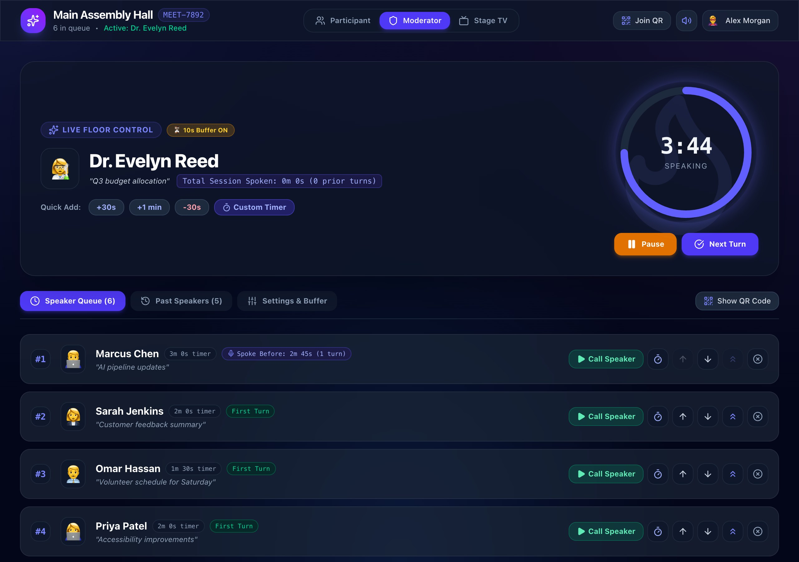
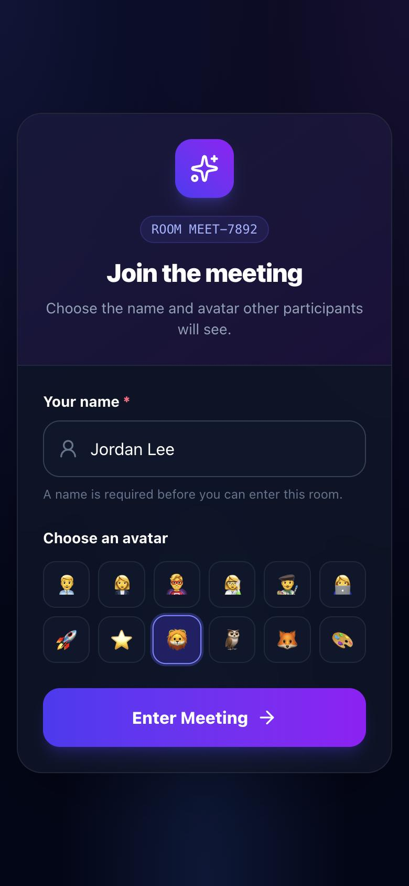
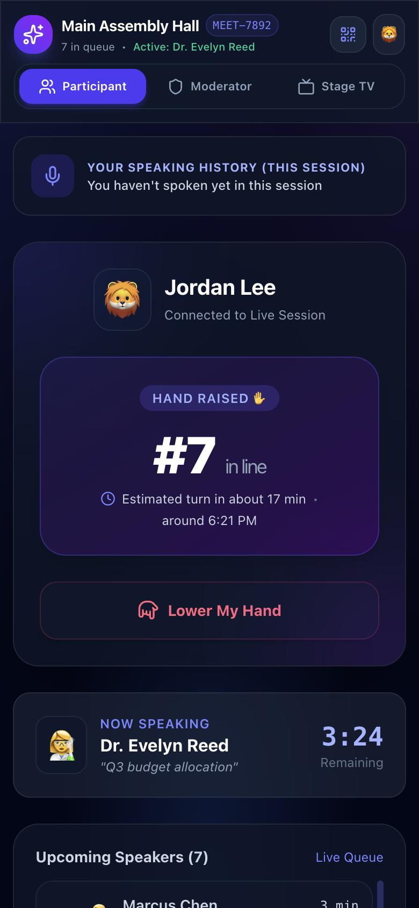
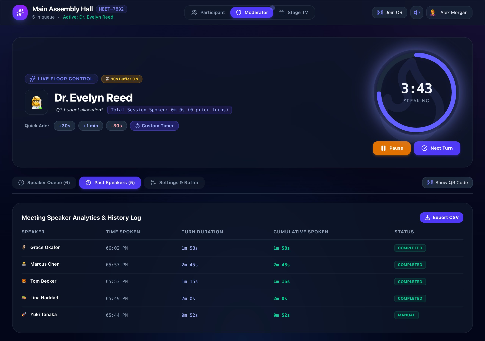
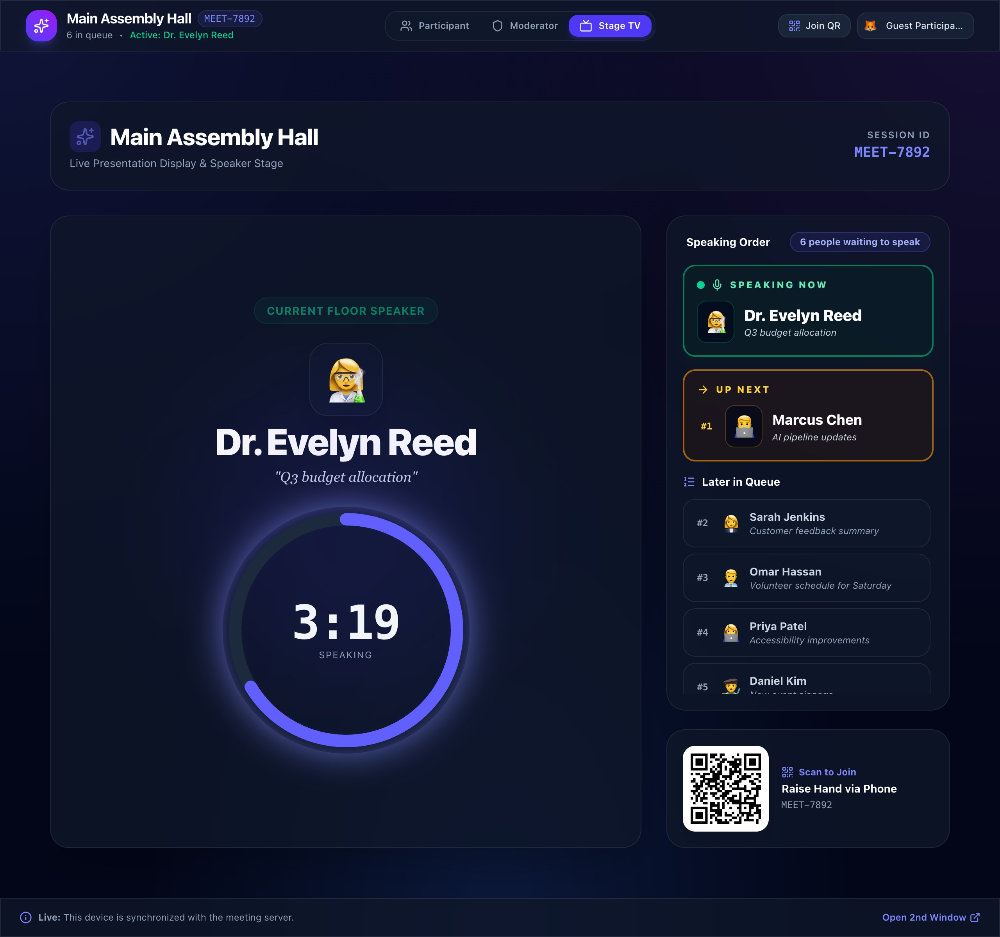

# Meeting Queue

A real-time speaker queue for in-person meetings. People raise their hand from their phone, the moderator calls them in order with a fair, visible timer, and a stage screen shows the room who is speaking and who is next.

One computer runs the meeting server on the local Wi-Fi. There is no cloud service and no sign-up: everyone scans one QR code.



| Join from a phone | Wait your turn |
| --- | --- |
|  |  |

## Features

**For participants (phone)**
- Join by scanning the QR code, then pick a name and avatar. The device remembers them for that room.
- Raise your hand with an optional topic, see your place in line and an estimated time for your turn, and lower your hand at any time.
- Follow the current speaker's live countdown and see your own speaking history for the session.
- End your own turn early with **Done Speaking**.
- The back button asks before leaving, so nobody drops out of the queue by accident.

**For the moderator**
- Unlock the controls with the server's PIN.
- Call the next person or anyone in the queue, optionally with a custom time. A short transition buffer gives them time to reach the microphone, and can be skipped or cancelled.
- Pause, resume, add or remove time, or set a new time for the current speaker.
- Reorder the queue (up, down, to the top) and dismiss entries.
- See how long each person has already spoken and how many turns they have had, so the floor can be shared fairly. Newcomers are marked **First Turn**.
- Review the speaker history with cumulative totals and export it to CSV.
- Change the default speaking time and choose whether it applies to everyone waiting or only from now on.
- Turn on auto-advance to call the next person when time runs out.
- Show the join QR code, copy the link, mute sounds, load demo participants, or reset the session.



**For the room (stage display)**
- Large current speaker and countdown, who is up next, and the rest of the speaking order.
- A QR code so people can join from their seats.
- A warning chime ten seconds before time runs out and an alert when it does, played on the moderator and stage screens only.



**Reliability**
- Every device shows the same queue: the server owns all changes and broadcasts them instantly.
- Timers count down on each device from the server's end time, corrected for clocks that are off, and catch up immediately when a phone wakes.
- Meetings are saved to disk and restored after a restart, including running timers.
- Devices reconnect automatically after a Wi-Fi drop and keep their place in line.

## How it works

```text
 Phones ─┐                       ┌──────────────── meeting server (Node) ───────────────┐
 Laptop ─┼── Socket.IO (Wi-Fi) ──┤ validate command → apply → broadcast to the room     │
 Stage  ─┘                       │ 250 ms timer loop · rooms · PIN sign-in · JSON file   │
                                 └────────────────────────────────────────────────────────┘
```

- Devices send **commands** such as `raise-hand` or `start-speaker`. The server checks the sender's identity and permission, validates the payload, applies the change, and broadcasts the new room state.
- Timers are sent as **end times**. The server broadcasts only when something changes hands (a speaker starts, time runs out, auto-advance); each device counts down on its own.
- The speaker **history** is sent separately and only when it changes.
- State is saved to `server/data/meetings.json` after changes and when the server stops.

The reasoning behind these choices, and what they cost, is in [docs/decisions.md](docs/decisions.md).

## Getting started

Requires Node.js 24 or newer; the server runs its TypeScript files directly.

```bash
npm install
npm run dev
```

Open the **Network** URL that Vite prints, for example:

```text
http://192.168.1.25:5173/?room=MEET-7892
```

Do not open the app as `localhost` when showing the QR code; phones cannot reach `localhost` on the host computer.

In development the moderator PIN is `7892`. Vite forwards the live connection to the meeting server, so phones only need port 5173.

## Running a real meeting

Build the app, then serve it and the live connection from one port:

```bash
npm run build
MODERATOR_PIN=your-private-pin npm start
```

The server prints the address to share, for example `http://192.168.1.25:3000/?room=MEET-7892`.

- If `MODERATOR_PIN` is not set, `npm start` generates a random 6-digit PIN and prints it. It changes on every restart and signs moderators out, so set `MODERATOR_PIN` for real meetings.
- Keep the host computer awake and allow incoming connections for Node in the firewall. Guest Wi-Fi networks often isolate devices from each other, which blocks phones from reaching the host.
- Stop the server with `Control+C` and wait for `Meeting server stopped. Port released.` Pending changes are saved before it exits.

## Rooms and views

| View | Link |
| --- | --- |
| Participant | `/?room=MEET-7892` |
| Stage display | `/?room=MEET-7892&view=stage` |
| Moderator | Open the participant link, select **Moderator**, enter the PIN |

Any room code works: `/?room=TEAM-SYNC` opens a separate meeting. Codes are 4 to 24 letters, digits or dashes and are not case-sensitive. A malformed code shows an "Invalid room code" screen.

## Configuration

| Variable | Used by | Default | Purpose |
| --- | --- | --- | --- |
| `MODERATOR_PIN` | server | `7892` in dev, random in production | PIN that unlocks the moderator controls |
| `MEETING_SERVER_PORT` | server, Vite | `3000` | Port of the meeting server; Vite's proxy follows it |
| `PORT` | server (`npm start` only) | — | Used when `MEETING_SERVER_PORT` is not set; ignored by `npm run dev` |
| `PUBLIC_URL` | server | the host's LAN address | Address put into join links and QR codes |
| `VITE_PUBLIC_URL` | client build | — | Same, fixed at build time |
| `VITE_SERVER_URL` | client build | the page's own address | Meeting server address, if it is hosted separately |

## Security and limits

- **Moderator sign-in.** Each sign-in gets its own token, valid for 12 hours. Only a keyed hash of each token is saved, and changing `MODERATOR_PIN` signs everyone out.
- **PIN guessing.** Five wrong PINs from one device lock it out for 30 seconds, doubling up to 5 minutes.
- **Validation.** Every command is validated on the server before it is applied.
- **Limits.** A server holds up to 50 rooms. Rooms with nobody queued or speaking are removed after 24 hours without activity (`MEET-7892` is kept). Each queue holds up to 200 people.

## Project structure

```text
shared/                  Types and rules used by both sides
  meeting.ts             The meeting model (queue, speakers, history, settings)
  protocol.ts            Socket messages and the typed command contract
  roomCode.ts            Room code validation
server/
  index.ts               Process entry: environment, PIN, startup output, Control+C
  app.ts                 startServer(): Express, Socket.IO and the store wired together
  meetingStore.ts        Rooms, sign-in, saving to disk, the 250 ms timer loop
  commands.ts            Runtime validation of incoming commands
  commandHandlers.ts     What each command does and who may send it
  room.ts                Room record and speaker transitions
  pinAttempts.ts         Wrong-PIN lockout
src/
  context/               Meeting context, live countdown context
  components/            Participant, stage, join and navbar views
  components/moderator/  Floor control, queue, history and settings panels
  utils/                 CSV export, countdown maths, speaking stats, sounds
docs/
  decisions.md           Product and design decisions
```

## Development

| Command | What it does |
| --- | --- |
| `npm run dev` | Meeting server and Vite with live reload |
| `npm test` | Unit, flow and socket integration tests (Node's built-in test runner) |
| `npm run lint` | Lint with oxlint |
| `npm run build` | Type-check client and server, then build the client into `dist/` |
| `npm start` | Serve the built app and the meeting server on one port |

## Known limitations

- One moderator PIN covers every room on a server.
- Only one server may use a data folder at a time.
- The moderator's buffer badge always reads "Transition Buffer (10s)", whatever the buffer setting is.
- The ten-second warning chime is not configurable from the interface.
